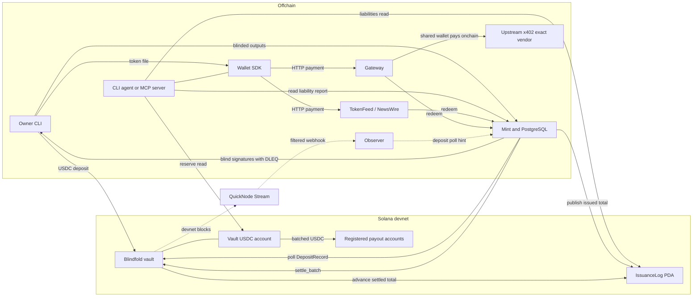

<div align="center">

# Blindfold

**Pay-per-call data access for AI agents on Solana.**

[](https://github.com/brockbenton/blindfold/actions/workflows/ci.yml)


[Public replay](https://brockbenton.github.io/blindfold/) · [Vault history](https://brockbenton.github.io/blindfold/vault/) · [Quick start](#quick-start) · [Architecture](#architecture) · [Documentation](#documentation)

</div>

## Overview

Standard x402 `exact` payments on Solana leave a USDC transfer for each purchase. A seller can attach a memo naming the feed or token. The demo's chain observer uses those transfers to infer what an agent is researching.

Blindfold is a custom x402 v2 scheme named `blindfold`. An owner deposits USDC into a shared Solana vault and receives blind-signed [Cashu](https://cashu.space) tokens. The agent pays for data in an HTTP header. Providers redeem the tokens at the mint and receive periodic USDC payouts from the vault. Direct Blindfold purchases leave no per-call transaction. The [public replay](https://brockbenton.github.io/blindfold/) shows the single-agent comparison and a crowd demo that illustrates what deposit amounts can reveal.

### What the demo shows

`pnpm demo` runs the same research twice on devnet, once with standard x402 and once with Blindfold, while the observer watches the chain. Script and talking points are in [the demo guide](docs/DEMO.md#what-each-act-shows).

| Act | Result |
|---|---|
| 1. Standard x402 | Three paid calls are three public transfers. The seller memo names SOL, and the observer signals **BUY SOL**. |
| 2. Fund | The owner deposits $1.00 into the vault and receives blind-signed tokens. The issuance log updates. |
| 3. Blindfold | The same research plus two NewsWire reads. The agent checks reserves against the issuance log first. The observer reports **NO SIGNAL**. |
| 4. Settle | One batched, rounded vault payout to both feeds at the next window. |
| 5. Scoreboard | The observer is scored against what the agent actually bought. Standard x402: 3/3 purchases attributed (wallet, feed and token). Blindfold: 0/5 attributed, 0 per-call transfers. With a single owner, payouts can still be linked to that owner and the feeds, but not to the token. Incomplete chain coverage is reported as inconclusive. |
| 6. Poisoned feed | A model-driven agent asks for owner approval on a 25¢ purchase. The session allowance stops a runaway loop with `budget_exhausted`, and an injected payment to an unregistered recipient is refused. |
| 7. Replay | A copied payment gets a 402. |
| 8. Reserve gate | The mint claims more than the vault holds, and the agent stops without paying. |

## Architecture



The mint credits a quote from the vault's `DepositRecord`, then signs the owner's blinded outputs. The owner verifies the DLEQ proofs and hands the agent a token file. Tokens are locked to the keys of providers active at funding time. When a provider returns HTTP 402, the wallet checks the offer and pays the exact amount in the `PAYMENT-SIGNATURE` header. The provider signs the proofs and redeems them before serving data. The mint records spent proofs and credits the provider in one database transaction.

### Components

| Component | Path | Responsibility |
|---|---|---|
| Vault | [`programs/vault`](programs/vault) | Holds USDC, registers providers and settles sequential batches. |
| Issuance log | [Vault instructions](programs/vault/src/instructions/issuance.rs), [mint job](services/mint/src/jobs/issuanceLog.ts) | Publishes the mint's cumulative issuance claim and tracks logged settlements. |
| Mint | [`services/mint`](services/mint) | Confirms deposits, blind-signs tokens, rejects double spends, and settles provider balances. |
| Wallet SDK and owner CLI | [`packages/wallet`](packages/wallet) | Funds provider-locked tokens, enforces payment policy and reconciles pending proofs. |
| Protocol | [`packages/protocol`](packages/protocol) | Shares constants, wire types, the vault IDL and reserve checks. |
| Provider | [`apps/mock-api`](apps/mock-api) | TokenFeed serves whale flow, order-book depth and trade signals for 5¢, 10¢ and 25¢ by default. It uses Coinbase market data with a deterministic fallback. |
| Gateway | [`apps/gateway`](apps/gateway) | Accepts Blindfold tokens and buys upstream data with x402 `exact` from one shared wallet. |
| CLI agent | [`agents/simple`](agents/simple) | Runs scripted or model-driven research. |
| MCP server | [`agents/mcp`](agents/mcp) | Exposes discovery, quotes, balances, purchases and reserve reports over stdio. |
| Observer, demo and replay | [`scripts`](scripts) | Reads the public transactions for standard x402 and Blindfold and scores the observer's attributions against ground truth. |

The gateway checks the upstream price before redeeming. It builds a new request, forwarding only query parameters permitted by its route map. The vendor sees the gateway's request and shared payer. Each upstream payment and any vendor memo stay public. The devnet demo vendor is TokenFeed with its `exact` rail enabled. See [Gateway setup](docs/design/06-gateway.md#setup-and-running-devnet).

## How Blindfold uses Solana

The vault holds USDC and pays registered providers. The mint runs settlement at fixed boundaries every 600 seconds by default. It holds recent redemptions for one window and rounds each payable amount down to a multiple of 10¢. The program itself accepts whole-cent amounts.

### Programs and accounts

| Program or account | Devnet address | Usage |
|---|---|---|
| Blindfold vault | `EsB6NfKVPipU5kEVm2jq14cjopbE7w9hPEFZWVu8jtMo` | Custody, provider registry, settlement and issuance log. |
| SPL Token | `TokenkegQfeZyiNwAJbNbGKPFXCWuBvf9Ss623VQ5DA` | USDC transfers via `transfer_checked`. |
| Associated Token Account | `ATokenGPvbdGVxr1b2hvZbsiqW5xWH25efTNsLJA8knL` | Creates the vault's USDC account for the `Config` PDA. |
| SPL Memo | `MemoSq4gqABAXKb96qnH8TysNcWxMyWCqXgDLGmfcHr` | Carries tags such as `whale-flow/SOL` on TokenFeed's `exact` payments. |
| System Program | `11111111111111111111111111111111` | Creates Solana accounts. |
| Circle devnet USDC mint | `4zMMC9srt5Ri5X14GAgXhaHii3GnPAEERYPJgZJDncDU` | Settlement asset. |

### Vault program

| Vault instruction | Signer | Effect |
|---|---|---|
| `initialize` | Initial admin | Creates `Config` and the vault token account. Sets the mint authority and per-deposit cap. |
| `deposit` | Owner | Transfers whole-cent USDC and writes a `DepositRecord` with the quote's random 32-byte reference. |
| `register_provider`, `deactivate_provider` | Admin | Registers a provider key and payout account, or permanently disables a record. |
| `settle_batch` | Mint authority | Pays 1–8 active providers to registered accounts. Requires the next batch ID. Advances the settled total when the issuance log is supplied. |
| `init_issuance_log`, `log_issuance` | Mint authority | Creates the log with initial totals, then adds issuance to the cumulative claim. |

The devnet issuance-log upgrade is recorded in the [vault deployment notes](docs/design/01-vault.md#issuance-log-added-november-2026). The reserve check compares the vault's USDC balance with the larger of the log's `issued - settled` and the mint's HTTP report. If the log is absent, the check requires the HTTP report and marks the result unverified. The [vault history page](https://brockbenton.github.io/blindfold/vault/) reads public devnet RPC from the browser. It shows a reserve coverage verdict (vault balance against the logged claim, read in one RPC context, with the slot, the margin and Explorer links), a machine-readable JSON snapshot, and the history of deposits, provider changes, settlements and issuance totals. Missing or malformed data gives an "unknown" verdict. The page refreshes once a minute while visible.

### Who touches the chain

| Actor | Reads | Writes |
|---|---|---|
| Owner | Vault configuration and deposit counter | `deposit` |
| Vault admin | Configuration and provider records | `initialize`, `register_provider`, `deactivate_provider` |
| Mint | Configuration, provider and deposit records, settlement state and issuance log | `settle_batch`, `init_issuance_log`, `log_issuance`. The issuance job runs every 5 s by default. |
| CLI agent and MCP server | Configuration, vault USDC balance and issuance log | None. Both use a token file. |
| Direct Blindfold provider | — | None for a Blindfold purchase. The provider redeems over HTTP and receives USDC from the vault. |
| Gateway | Upstream payment state through the `exact` client | Signs upstream `exact` payments from its shared wallet. The upstream facilitator submits the transaction. |
| Observer and vault history | Public transactions. Vault history also reads the current balance and issuance log. | None |

## Agent decision loop and safety limits

### Scripted loop

The scripted CLI checks its balance, discovers active providers and chooses one by `--provider` or `--topic`. It checks reserves, pays for `--calls` requests sequentially and reports the results and balance change.

### LLM loop (`--llm`)

In `--llm` mode, the model receives a research goal and the tools `list_providers`, `get_balance`, `buy_data` and `final_answer`. For a purchase, the loop runs the reserve gate and passes the remaining session budget to the wallet. The wallet checks the offer against that budget and the per-call cap, then asks for approval if required. The loop returns the purchase result to the model. The run ends with a BUY, SELL or HOLD decision or defaults to HOLD after ten turns. Feed content can carry instructions. Payment policy runs outside the model.

### MCP clients

The MCP server exposes `list_providers`, `get_balance`, `quote`, `buy_data` and `check_reserves`. The quote reads the unpaid HTTP 402, and `buy_data` applies the reserve gate independently. MCP also checks that a requested URL is on a registered provider's origin before making the request. See [Claude Code setup](agents/mcp/README.md#add-it-to-claude-code) and [Claude Desktop setup](agents/mcp/README.md#add-it-to-claude-desktop).

### Safety limits

| Control | CLI default | MCP default | Enforcement |
|---|---|---|---|
| Provider lock and allowlist | Providers active at funding | Same | The mint requires a registered signer in the token's P2PK lock. `WALLET_ALLOWLIST` can narrow wallet spending. |
| Per-call cap | 10¢ | 30¢ | The wallet refuses offers over `MAX_PER_CALL_CENTS`. The CLI also accepts `--max-per-call`. |
| Owner approval | Above 20¢, 60 s timeout | Above 20¢, 120 s timeout | The wallet checks the cap first. The CLI prompts in the terminal, the demo also offers dashboard approval, and MCP uses elicitation. Denial, timeout or an MCP client without elicitation blocks the purchase. |
| Session budget | 30¢ with `--llm` | 50¢ per server process | `--budget` (CLI) or `BUDGET_CENTS` (MCP). The wallet checks each validated price against the budget left, inside its payment lock, and refuses with `budget_exhausted` before any proof leaves, so no purchase crosses it. |
| Reserve gate | Before call 1 and every 10 calls thereafter | Before the first and every 10 paid calls thereafter | `RESERVE_CHECK_EVERY` sets the interval. A failure stops the CLI with exit code 7. MCP refuses and checks again on the next attempt. |
| Total funded value | Token file balance | Same | The wallet selects proofs for the exact price. The mint rejects spent proofs. |

The CLI's default cap is below the approval threshold. The demo raises the cap so a 25¢ request reaches the approval hook. See [agent design](docs/design/05-agent.md#owner-approval) and [MCP limits](agents/mcp/README.md#limits).

## Accepting Blindfold as an x402 provider

A provider that already serves x402 adds Blindfold as one more entry in a route's `accepts` list. Clients pick the scheme they have registered: the Blindfold wallet pays `blindfold`, and a standard x402 client keeps paying `exact` on the same route. This is the wiring TokenFeed uses ([`apps/mock-api/src/app.ts`](apps/mock-api/src/app.ts)). The gateway uses the same wiring.

```ts
import { Hono } from "hono";
import { paymentMiddleware, x402ResourceServer } from "@x402/hono";
import { SOLANA_DEVNET_CAIP2, USDC_DEVNET_MINT, centsToBaseUnits } from "@blindfold/protocol";
import { BlindfoldFacilitator } from "mock-api/x402/blindfoldFacilitator";
import { CashuServerScheme } from "mock-api/x402/cashuServerScheme";

const facilitator = new BlindfoldFacilitator({ mintUrl: MINT_URL, providerSecretKey: PROVIDER_SECRET_HEX });
const server = new x402ResourceServer([facilitator /*, your exact facilitator */])
  .register(SOLANA_DEVNET_CAIP2, new CashuServerScheme({ mintUrl: MINT_URL, providerPubkey: facilitator.providerPubkey }));

const app = new Hono();
app.use(paymentMiddleware({
  "GET /v1/data/:topic": {
    accepts: [
      { scheme: "blindfold", network: SOLANA_DEVNET_CAIP2, payTo: facilitator.providerPubkey,
        price: { amount: String(centsToBaseUnits(5)), asset: USDC_DEVNET_MINT } },
      // { scheme: "exact", ... } stays as it was
    ],
    description: "whale flow", mimeType: "application/json",
  },
} as never, server));
app.get("/v1/data/:topic", (c) => c.json({ topic: c.req.param("topic") /* ... */ }));
```

What the provider does and doesn't do:

- **Keys and registration.** It generates a secp256k1 provider key and keeps it. The vault admin registers the public key with a USDC payout account ([runbook](docs/RUNNING.md#4-mock-api-and-owner-cli)). Tokens are locked to registered keys, so an unregistered server cannot redeem them.
- **Redemption before serving.** The facilitator signs the token's P2PK lock and redeems it at the mint before the handler runs. The mint rejects spent proofs, so a replayed payment gets a 402.
- **Payout.** The mint credits redemptions and pays registered providers from the vault in batched settlements on fixed windows. Nothing goes onchain per call.
- **No onchain work.** The provider doesn't need Solana RPC, a wallet or a facilitator service for Blindfold.

The facilitator and scheme are workspace exports of `apps/mock-api`, not a published package yet. A standalone adapter is on the [roadmap](docs/roadmap.md#phase-4-recoverable-delivery-and-a-provider-adapter).

## QuickNode Streams configuration

| Setting | Value |
|---|---|
| Network | `solana-devnet` |
| Dataset | `block`, starting at the chain tip, with batches of five and elastic batching enabled. |
| Filter | [`scripts/streams/observer-filter.js`](scripts/streams/observer-filter.js). Keeps successful transactions that change a watched USDC balance. Extracts amounts and SPL memos and decodes `DepositMade` logs for the vault. |
| Destination | `POST /streams` in `pnpm demo` or `pnpm bot`, exposed through a cloudflared tunnel by default. The receiver verifies `X-QN-Signature` using the per-run security token. |
| Provisioning | [`pnpm streams:setup`](scripts/streams-setup.ts) creates a paused Stream or updates its filter. The watcher configures and activates it for the run and pauses it on clean exit. |

Filtering at QuickNode reduces block payloads to the events the observer needs. The Stream's reported tip lets the demo wait for delivery past a slot before reporting that it saw no new payment. The observer falls back to RPC when Streams are unavailable or silent for 20 seconds, and deduplicates observations across both sources.

A `DepositMade` event tells the demo to call the mint's authenticated `POST /v1/blindfold/admin/poll-deposits`. The standalone bot does the same when `MINT_URL` and `MINT_ADMIN_TOKEN` are set. The mint joins any poll already in flight and credits only vault-owned `DepositRecord` accounts. The two-second timer continues during funding. The demo stops that timer after its funding step. See [Stream setup and filter test](docs/DEMO.md#quicknode-streams-optional).

## Quick start

Use Node.js 22+ and pnpm 10.33.0. Add PostgreSQL for the mint, demo and database tests. Install Rust 1.89.0, Anchor 1.2.2 and Solana tools to build or test the vault locally.

```sh
git clone https://github.com/brockbenton/blindfold.git
cd blindfold
npx -y pnpm@10.33.0 install --frozen-lockfile
npx -y pnpm@10.33.0 -r build
node agents/simple/dist/main.js --fake --json
```

The last command runs the agent with stubbed wallet, provider and reserve reads. For a real payment or the full tests, follow the [local runbook](docs/RUNNING.md).

| To run | Command | What you need |
|---|---|---|
| Narrated devnet demo | `pnpm demo` | Funded devnet keys in `.keys/` and PostgreSQL. An LLM key enables the model-driven part of Act 6. See [demo setup](docs/DEMO.md#before-the-first-run). |
| Live demo with Claude | `pnpm serve --local --window 60`, `pnpm watch`, `pnpm rival` | The same as the narrated demo, plus the [MCP server](agents/mcp/README.md#set-up) in Claude. See [live demo](docs/DEMO.md#live-demo-with-claude-and-mcp). |
| Crowd comparison | `pnpm crowd` | Local validator tools, PostgreSQL and `anchor build`. See [crowd demo](docs/DEMO.md#crowd-demo-privacy-needs-other-people). |
| Persistent devnet stack | `pnpm serve --local` | Deployed vault, registered TokenFeed, mint authority key and PostgreSQL. `pnpm serve` opens public tunnels by default. Follow the printed funding commands or use [MCP setup](agents/mcp/README.md#set-up). See [live stack](docs/RUNNING.md#9-live-stack-pnpm-serve). |

The commands assume pnpm 10.33.0 is available as `pnpm`. You can substitute `npx -y pnpm@10.33.0`. The programs read environment variables from the process. See [`.env.example`](.env.example) for baseline settings and [configuration](docs/design/00-interfaces.md#9-repo-layout-and-configuration) for overrides. The real CLI agent requires `TOKEN_FILE` or `--token-file` and explicit `SOLANA_RPC_URL`, `VAULT_PROGRAM_ID` and `USDC_MINT` settings.

## Security model and limitations

Blindfold is an unaudited devnet prototype. The mint, vault admin and upgrade authority are trusted. The program restricts payouts to registered accounts. The mint authority chooses amounts, and the program has no proof that payouts match honest redemptions. The issuance log preserves the published claim. An operator can omit issuance, and separate RPC and HTTP reads can temporarily disagree.

Deposits and provider payouts are public. A single depositor, distinctive amounts or repeated timing can link owners to payouts. Providers see requests and network metadata. The mint sees redemption amounts and timing. The gateway pools payment identities while leaving upstream transfers visible. Blindfold has no network anonymity layer.

Approval and limits protect against a manipulated model. A compromised process or leaked token file can still spend at allowed providers. Redemption precedes delivery, so a lost response can consume tokens without returning data. See [wallet recovery limits](docs/design/04-wallet-sdk.md#recovery-limits) and the [roadmap](docs/roadmap.md) for planned fixes and what is out of scope.

## Documentation

| Document | Contents |
|---|---|
| [Run it locally](docs/RUNNING.md) | Setup, service commands and vault checks |
| [Run the demo](docs/DEMO.md) | Demo, observer, crowd comparison, Streams and recording |
| [MCP setup](agents/mcp/README.md) | Claude Code, Claude Desktop, tools and limits |
| [Why Blindfold](docs/why-blindfold.md) · [Design](docs/design.md) | Motivation, trust and privacy |
| [Interfaces](docs/design/00-interfaces.md) | Wire formats, accounts, APIs and configuration |
| Component designs | [Vault](docs/design/01-vault.md) · [Mint](docs/design/02-mint.md) · [Provider](docs/design/03-mock-api.md) · [Wallet](docs/design/04-wallet-sdk.md) · [Agent](docs/design/05-agent.md) · [Gateway](docs/design/06-gateway.md) |
| [Roadmap](docs/roadmap.md) | Submission checklist, post-submission phases and what we are not doing |
| [Security references](docs/security-sources.md) | Protocol and security background |
