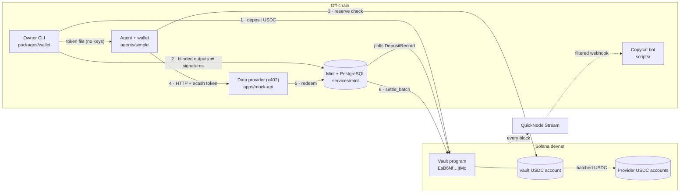

<div align="center">

# Blindfold

**Private, pay-per-call data access for AI agents on Solana.**

Blindfold is an x402 payment scheme that lets agents buy data per request without publishing what they research onchain.

[](https://github.com/brockbenton/blindfold/actions/workflows/ci.yml)


**[▶ Watch a recorded devnet run](https://brockbenton.github.io/blindfold/)**: the demo's dashboard and narration in your browser, nothing to install.

[Quick start](#quick-start) · [Architecture](#architecture) · [Solana integration](#how-blindfold-uses-solana) · [Agent](#agent-decision-loop-and-safety-limits) · [Demo](docs/DEMO.md) · [Docs](#documentation)

</div>

---

## Overview

Data vendors such as CoinGecko, CoinMarketCap, Birdeye and Messari sell market data per request over x402. With the standard `exact` scheme, every call is a USDC transfer from the agent's wallet to the provider, usually with a memo naming the feed. Anyone reading Solana can see which wallet bought which data, how often and when. A burst of purchases about one token is a trading signal, and copy-trading bots can act on it before the agent does.

Blindfold replaces the per-call transfer with **blind-signed ecash**. An owner deposits USDC into a Solana vault once and receives tokens for the agent. The agent pays each call with a token in an HTTP header. Providers redeem tokens at the mint and get paid in periodic batch payouts from the vault. A watcher sees one deposit go in and batched payouts come out, but not who bought what, or when.

[Why Blindfold](docs/why-blindfold.md) covers the evidence, use cases and competitive landscape.

### Key features

- **No per-call onchain footprint.** Payments are HTTP headers, not transactions. The agent has no wallet and no onchain identity.
- **Drop-in x402.** A custom x402 v2 scheme, `blindfold`, built on [Cashu](https://cashu.space) ecash and served alongside or instead of `exact` on the same routes.
- **Spend controls the model can't bypass.** Tokens only pay registered providers. A per-call cap, a session budget, and owner approval for large purchases are all enforced in code, not in the prompt.
- **Verifiable reserves.** Before paying, the agent reads the vault's USDC balance on Solana and refuses a mint that reports more liabilities than the vault holds.
- **Onchain custody.** An Anchor program holds the funds and only pays registered provider accounts, in strictly sequential batches.
- **Live adversary.** Copycat, a front-running bot fed by a QuickNode Stream, shows what a watcher learns from `exact` and what it learns from Blindfold.

---

## Contents

- [Architecture](#architecture)
- [How Blindfold uses Solana](#how-blindfold-uses-solana)
- [Agent decision loop and safety limits](#agent-decision-loop-and-safety-limits)
- [QuickNode Streams configuration](#quicknode-streams-configuration)
- [Quick start](#quick-start)
- [Security model and limitations](#security-model-and-limitations)
- [Documentation](#documentation)

---

## Architecture



### Payment flow

| Step | What happens | Onchain |
|---|---|---|
| **1. Deposit** | The owner requests a mint quote and deposits USDC into the vault with the quote's random 32-byte reference. | One `deposit` transaction |
| **2. Issue** | The mint sees the `DepositRecord` and blind-signs the owner's outputs, with DLEQ proofs. Tokens are P2PK-locked to the registered providers' keys. The agent receives a token file, never a Solana key. | Nothing |
| **3. Check** | Before the first payment, and periodically after that, the agent compares the vault's USDC balance with the mint's reported liabilities. | Read only |
| **4. Pay** | The provider answers HTTP 402. The wallet checks price, asset, mint and provider, then retries with an exact token payment in the `PAYMENT-SIGNATURE` header. | Nothing |
| **5. Redeem** | The provider signs and redeems the tokens. In one database transaction, the mint marks them spent and credits the provider. The data is served only after that. Replays are refused. | Nothing |
| **6. Settle** | On a fixed schedule (every 10 minutes by default), the mint signs one `settle_batch` paying up to eight providers' registered USDC accounts, in amounts rounded to 10 cents. | One payout transaction, no payer |

### Components

| Component | Path | Responsibility |
|---|---|---|
| **Vault program** | [`programs/vault`](programs/vault) | Anchor program that holds deposited USDC, keeps the provider registry and pays sequential, capped batches to registered payout accounts. |
| **Mint** | [`services/mint`](services/mint) | Cashu-style mint (HTTP + PostgreSQL). Confirms deposits, issues blind signatures, verifies provider signatures, rejects double spends, tracks balances and settles batches. |
| **Wallet SDK + owner CLI** | [`packages/wallet`](packages/wallet) | x402 `blindfold` client scheme. Funds provider-locked tokens, pays exact amounts, enforces caps and allowlists, runs the owner-approval hook and reconciles pending payments. |
| **Protocol** | [`packages/protocol`](packages/protocol) | Shared constants, environment loading, vault IDL and wire types. |
| **Provider** | [`apps/mock-api`](apps/mock-api) | Example data feed (whale flow, order-book depth, premium signals). Serves x402 `blindfold`, and optionally standard `exact` as a baseline. |
| **Agent** | [`agents/simple`](agents/simple) | Scripted or LLM-driven trading-research agent. See [Agent decision loop](#agent-decision-loop-and-safety-limits). |
| **Copycat, demo and dashboard** | [`scripts`](scripts) | Adversary bot that reads only public Solana data, plus the narrated devnet demo, a live dashboard and the multi-owner crowd simulation. |
| **Tests** | [`tests/integration`](tests/integration), `*/test` | Unit tests, a PostgreSQL integration suite and the LiteSVM program tests. |

Wire formats, account layouts, HTTP APIs and configuration are specified in [Interfaces](docs/design/00-interfaces.md).

---

## How Blindfold uses Solana

Solana is the settlement and custody layer. USDC enters the system through one vault deposit and leaves through batched payouts to registered providers. Everything in between happens off-chain. The vault's public state lets anyone, including the agent itself, check that the mint is solvent.

### Programs and accounts

| Program / account | Address (devnet) | Usage |
|---|---|---|
| **Blindfold vault** (deployed by this project) | `EsB6NfKVPipU5kEVm2jq14cjopbE7w9hPEFZWVu8jtMo` | Custody, provider registry and batch settlement |
| SPL Token | `TokenkegQfeZyiNwAJbNbGKPFXCWuBvf9Ss623VQ5DA` | All USDC movement, through `transfer_checked`. Token-2022 mints are rejected at `initialize`. |
| Associated Token Account | `ATokenGPvbdGVxr1b2hvZbsiqW5xWH25efTNsLJA8knL` | Creates the vault's USDC account, owned by the `Config` PDA |
| SPL Memo | `MemoSq4gqABAXKb96qnH8TysNcWxMyWCqXgDLGmfcHr` | Used by the standard x402 `exact` baseline to tag each payment, such as `whale-flow/SOL`. This is the leak Copycat reads. Blindfold writes no memos. |
| System Program | `11111111111111111111111111111111` | PDA account creation |
| USDC mint (Circle devnet) | `4zMMC9srt5Ri5X14GAgXhaHii3GnPAEERYPJgZJDncDU` | Settlement asset, configurable through `USDC_MINT` |

### Vault program

| Instruction | Signer | Purpose |
|---|---|---|
| `initialize` | Admin | Creates the `Config` PDA and the vault's USDC account, and sets the mint authority and a per-deposit maximum. |
| `deposit` | Owner | Transfers whole-cent USDC into the vault and writes a `DepositRecord` (index, depositor, amount, deposit reference). Emits `DepositMade`. |
| `register_provider` | Admin | Records a provider's ecash public key and its USDC payout account. |
| `deactivate_provider` | Admin | Permanently disables a provider record. |
| `settle_batch` | Mint authority | Pays 1–8 active providers from the vault, to their registered payout accounts only. A strictly increasing `batch_id` makes a retried batch fail instead of paying twice. |

PDAs: `Config` (`["config"]`), `DepositRecord` (`["deposit", u64]`), `ProviderRecord` (`["provider", u32]`). Errors, events and security checks are documented in [Vault design](docs/design/01-vault.md).

### Who touches the chain

| Actor | Reads | Writes |
|---|---|---|
| Owner | — | One `deposit` per funding |
| Mint | `DepositRecord` accounts, polled every 2 s. Deposits are credited from program state, never from third-party feeds. | `settle_batch` on a fixed schedule |
| Agent | `Config` and the vault's USDC balance, for the reserve check | **Nothing.** The agent holds no Solana key. |
| Provider | — | Nothing. It receives USDC in its registered account. |
| Copycat | Every transaction touching provider payout accounts or the vault, through QuickNode Streams with RPC fallback | — |

### What a watcher sees

| | Standard x402 `exact` | Blindfold `blindfold` |
|---|---|---|
| Per data call | One USDC transfer: agent wallet → provider, with a memo naming the feed and token | No transaction |
| Funding | — | One deposit into the shared vault |
| Provider revenue | Visible per call, per payer | One batched payout per window, rounded, with no payer |
| What Copycat infers | "BUY SOL", seconds after the agent's research | No signal; payouts can't be attributed once several owners deposit (`pnpm crowd`) |

---

## Agent decision loop and safety limits

The agent ([`agents/simple`](agents/simple)) has two decision loops over the same tools and wallet. In both, **the model or script decides what to buy, and code decides what is allowed.**

### Scripted loop

1. Read the wallet balance. Refuse to run with an empty budget.
2. Discover active providers from the mint. Select one by `--provider`, by `--topic`, or take the first active provider.
3. **Reserve gate:** check vault reserves before call 1 and every `RESERVE_CHECK_EVERY` calls (default 10). A failure stops the run before any payment, with exit code 7.
4. Pay for `--calls` requests sequentially through the wallet, then report the results and balance changes.

### LLM loop (`--llm`)

The model talks to any OpenAI-compatible chat completions endpoint (Gemini by default) and sees four tools:

| Tool | Returns |
|---|---|
| `list_providers` | Name, URL, price and topics of active providers |
| `get_balance` | Remaining tokens in cents |
| `buy_data(url)` | The paid response, or `{ refused: reason }` |
| `final_answer(decision, rationale)` | Ends the run with `BUY`, `SELL` or `HOLD` |

Each turn:

```
┌─▶ 1. Send the conversation and tools to the model
│   2. Model calls buy_data(url)
│      ├─ Budget        session spend < --budget?            no → refused: budget_exhausted
│      ├─ Reserve gate  vault USDC ≥ mint liabilities?       no → stop run (exit 7)
│      ├─ Wallet policy allowed provider, asset, mint,
│      │                exact amount ≤ --max-per-call?       no → refused
│      ├─ Owner approval price > --approve-over?             ask owner; deny or timeout → refused
│      └─ Pay → data
│   3. Return the result or refusal to the model as a tool message
└── 4. Repeat until final_answer, or HOLD after 10 turns
```

Provider responses are **untrusted input**. They go to the model unchanged, and this is where a prompt injection arrives. None of the limits above depend on the model following instructions. Refusals come back as tool results, not crashes, so a hijack attempt costs nothing and the run continues. The reserve gate and owner approval are deliberately **not tools**: a manipulated model could skip a tool it was meant to call voluntarily.

### Safety limits

| Limit | Default | Enforced by | Stops |
|---|---|---|---|
| **No keys** | — | Architecture | The agent holds ecash tokens, no Solana or provider keys. Nothing to leak or sign with. |
| **Provider lock** | All active providers at funding time | Token P2PK lock, checked by the mint | Paying any unregistered party, including an attacker's server |
| **Allowlist** | Union of the tokens' signer sets | Wallet (`WALLET_ALLOWLIST`) | Narrows spending further in wallet code |
| **Per-call cap** | 10¢ | Wallet (`--max-per-call`) | Overpriced 402 challenges. Refused without asking. |
| **Owner approval** | Above 20¢ | Wallet payment hook (`--approve-over`) | Large purchases. Approve or deny in the terminal or dashboard. No answer within `APPROVAL_TIMEOUT_S` (60 s) counts as a denial. |
| **Session budget** | 30¢ | LLM loop (`--budget`) | Runaway spending in one session |
| **Step limit** | 10 model turns | LLM loop | Infinite tool loops. Ends with `HOLD`. |
| **Reserve gate** | Every 10 paid calls | Agent loop (`RESERVE_CHECK_EVERY`) | Paying a mint that claims more liabilities than the vault holds. Fails closed on any RPC or mint error. |
| **Total budget** | Value of the token file | Ecash | Spending beyond what the owner funded |

Approval runs inside the wallet's x402 payment hook. That hook is the first point where the exact price, provider key and asset are all known, and every payment passes through it. It asks only after all other checks pass, so the owner is never prompted for a payment the wallet would refuse.

These controls stop a *manipulated model*, not a *compromised agent process*. A fooled model can still waste its budget at registered providers, in purchases at or below the approval threshold. It cannot pay anyone else. `pnpm demo` Act 6 demonstrates this with a poisoned feed. Full details: [Agent design](docs/design/05-agent.md).

---

## QuickNode Streams configuration

Copycat plays a real front-running bot, and real bots don't poll. A QuickNode Stream pushes every transaction that pays a data feed or touches the vault to Copycat as it lands, already reduced to the fields Copycat needs. The demo's dashboard, its narration and Copycat's `BUY SOL` call all run on this data.

| Setting | Value |
|---|---|
| **Network** | `solana-devnet`, where the vault and the demo run |
| **Dataset** | `block`: full blocks with parsed transactions, token balances and logs. Batches of 5 blocks, elastic batching on, starting at the chain tip. |
| **Filter** | [`scripts/streams/copycat-filter.js`](scripts/streams/copycat-filter.js) (JavaScript). Watched addresses are filled in at upload. |
| **Destination** | Webhook: `POST /streams` on a receiver inside `pnpm demo` or `pnpm bot`, exposed through a free cloudflared quick tunnel. Every delivery is verified against QuickNode's HMAC signature (`X-QN-Signature`), with a fresh security token per run. |
| **Provisioning** | [`pnpm streams:setup`](scripts/streams-setup.ts), through the Streams REST API. Each run replaces the Stream with one pointing at its own tunnel and pauses it on exit. |

### Filter logic

For each successful transaction in a batch:

1. Skip it unless it changes the USDC balance of a watched token account: a data feed's payout account or the vault's USDC account.
2. Derive the movement (sender, source account, amount) from pre and post token balances, so any instruction layout works. This mirrors Copycat's RPC path, and a test checks that both give identical results on recorded devnet blocks.
3. Attach the SPL Memo, which is where an x402 `exact` payment says what was bought (`whale-flow/SOL`).
4. For vault transactions, decode the Anchor `DepositMade` event from the logs.

Each batch returns `{ tip, records, deposits }`, even when nothing matched:

```json
{ "signature": "KCWm...tRH4A", "slot": 522985052, "time": 1794850619, "account": "GVaF...VECe",
  "sender": "4pHm...usqE", "senderAccount": "8dHd...Vkk3", "recipient": "ELPm...5bzd",
  "amount": "50000", "memo": "whale-flow/SOL" }
```

### Why this setup

- **Latency.** In devnet tests the record reached Copycat by the time the sender's own confirmation returned. Polling needs two RPC calls per account per pass, plus one per new transaction, and hits public rate limits.
- **Server-side filtering.** A sampled devnet block was about 250 KB. The filter forwards a few hundred bytes per relevant transaction, already in Copycat's `Observation` shape, so the inference and dashboard code needed no changes.
- **Proof of absence.** The `tip` in every batch shows how far the Stream has read. Before the demo claims Blindfold left nothing onchain, Copycat waits until the Stream has delivered past the current slot.
- **Graceful fallback.** The demo never depends on QuickNode. With no API key, no tunnel, a refused request or 20 s without a delivery, Copycat polls RPC and switches back when deliveries resume. Both sources feed one deduplicated list.
- **Free tier.** The trial plan allows one active Solana Stream at the tip, with no backfill, so `pnpm bot` reads its starting history over RPC.

The mint deliberately does **not** credit deposits from the Stream. Crediting money from a third-party feed would weaken its trust model, so it keeps reading `DepositRecord` accounts directly. Setup steps: [Run the demo › QuickNode Streams](docs/DEMO.md#quicknode-streams-optional).

---

## Quick start

### Prerequisites

| Requirement | Needed for |
|---|---|
| Node.js 22+ and pnpm 10.33.0 (`corepack enable`, or `npx -y pnpm@10.33.0`) | Everything |
| PostgreSQL 16+ (local or `docker compose up -d postgres`) | Mint and integration tests |
| Rust 1.89.0, Anchor 1.2.2, Solana CLI | Only to build, test or redeploy the vault program |

### 1. Install and build

```sh
git clone https://github.com/brockbenton/blindfold.git && cd blindfold
pnpm install --frozen-lockfile
pnpm -r build    # workspace packages import each other's dist/ output
```

### 2. Run the agent with no dependencies

```sh
node agents/simple/dist/main.js --fake --json
```

`--fake` stubs the wallet, providers and reserve reads. Use it to check the build, not to demonstrate a real payment.

### 3. Run the test suite

```sh
export PG_BIN=/usr/lib/postgresql/17/bin            # where your PostgreSQL binaries live
export DATABASE_URL="$(services/mint/scripts/dev-pg.sh)"
pnpm -r typecheck
pnpm -r test
```

Integration tests skip when `DATABASE_URL` is unset. Program tests: `anchor build && cargo test --locked -p vault`.

### 4. Run the devnet demo

```sh
pnpm demo
```

The demo uses the deployed vault, so it needs no Rust or Solana tools. It needs funded devnet keys in `.keys/`. Optional extras: an LLM key in `.keys/llm.key` for the AI-agent act, a private devnet RPC through `SOLANA_RPC_URL`, and a QuickNode API key in `.keys/quicknode.json` for Streams. See [Run the demo](docs/DEMO.md) for the full checklist and what each act shows. To watch without running anything, open the [recorded run](https://brockbenton.github.io/blindfold/).

### Configuration

Programs read process environment variables; `.env` is not loaded automatically. [`.env.example`](.env.example) lists every setting.

| Variable | Used by | Default |
|---|---|---|
| `SOLANA_RPC_URL` | All Solana clients | `https://api.devnet.solana.com` |
| `VAULT_PROGRAM_ID` | All Solana clients | Deployed devnet vault |
| `USDC_MINT` | All Solana clients | Circle devnet USDC |
| `DATABASE_URL`, `MINT_SEED`, `MINT_AUTHORITY_KEYPAIR`, `MINT_ADMIN_TOKEN` | Mint | — |
| `PROVIDER_SECRET_KEY`, `PRICE_CENTS`, `PUBLIC_URL` | Provider | — |
| `TOKEN_FILE`, `MINT_URL` | Wallet, agent | —, `http://localhost:3338` |
| `MAX_PER_CALL_CENTS`, `APPROVAL_OVER_CENTS`, `APPROVAL_TIMEOUT_S`, `WALLET_ALLOWLIST` | Wallet | 10, 20, 60, all locked providers |
| `LLM_API_KEY`, `LLM_BASE_URL`, `LLM_MODEL` | Agent (`--llm`) | —, Gemini, `gemini-3.5-flash-lite` |

Running each service by hand (fake-chain mint, provider, owner CLI, real-vault checks) is covered step by step in [Run it locally](docs/RUNNING.md).

---

## Security model and limitations

Blindfold is a **prototype on Solana devnet**. It has not been independently audited and is not a production custody service.

| Area | Guarantee | Limitation |
|---|---|---|
| **Custody** | The vault pays only registered provider accounts, in sequential batches. | The mint can censor, under-report issuance or misuse its settlement authority. The vault does not prove payouts match honest redemptions. Deployment and upgrade authorities remain trusted. |
| **Reserves** | The agent checks the vault balance against reported liabilities and fails closed. | It cannot detect a mint that lies about issuance. The RPC and mint reads are not an atomic snapshot. |
| **Privacy** | No per-call transactions. Payouts are batched, rounded and carry no payer. | Deposits and payouts are public. With one depositor, a payout is linked to that deposit; privacy needs several owners with similar amounts and timing (`pnpm crowd`). Providers see queries and IP addresses, and the mint sees redemption amounts and times. No relay, Tor or Oblivious HTTP layer is implemented. |
| **Spending** | See [Safety limits](#safety-limits). | An agent can waste its budget at allowed providers. Payment doesn't establish that returned data is accurate. Leaked tokens can still buy from registered providers. |
| **Recovery** | Funding resumes from persisted checkpoints. | A lost paid response can consume tokens without delivering data. Deposits are not exactly-once across every crash. See [wallet recovery limits](docs/design/04-wallet-sdk.md#recovery-limits). |
| **Scope** | — | No mainnet, refunds, swap/change, key rotation or sanctions screening. Mint signing helpers are not constant-time. |

The vault deployment and a full devnet acceptance run on November 16, 2026 are recorded in the [vault implementation notes](docs/design/01-vault.md#10-implementation-notes-and-decisions). Those records don't guarantee the deployment is still available. Planned work (protocol-level owner co-signing, onchain issuance logging, hidden provider revenue) is tracked in [MVP and add-ons](docs/mvp.md).

---

## Documentation

| Document | Contents |
|---|---|
| [Run it locally](docs/RUNNING.md) | Installation, PostgreSQL, running each service, CLI and tests |
| [Run the demo](docs/DEMO.md) | One-command devnet demo, Copycat, dashboard, crowd simulation, Streams setup, recorded replay |
| [Why Blindfold](docs/why-blindfold.md) | Problem, evidence, use cases and landscape |
| [Design](docs/design.md) | End-to-end flow, trust, privacy and future options |
| [Interfaces](docs/design/00-interfaces.md) | Wire formats, accounts, HTTP APIs and configuration |
| Component designs | [Vault](docs/design/01-vault.md) · [Mint](docs/design/02-mint.md) · [Provider](docs/design/03-mock-api.md) · [Wallet](docs/design/04-wallet-sdk.md) · [Agent](docs/design/05-agent.md) |
| [MVP and add-ons](docs/mvp.md) · [Plan](docs/plan.md) | Implemented scope, roadmap and remaining work |
| [Security sources](docs/security-sources.md) | External references and their relevance |
