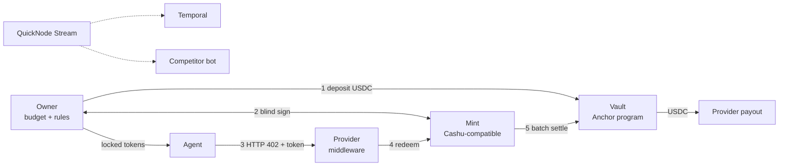

# Blindfold: Design

How it works. Pitch is in [`README.md`](../README.md), scope in [`mvp.md`](mvp.md). Parts marked *(add-on N)* are outside the MVP; see [`mvp.md`](mvp.md#add-ons).

## One purchase end to end

1. **Deposit.** The owner deposits devnet USDC into the vault, ideally ahead of and independent from any research task. The mint confirms the deposit from the vault program's state. *(Add-ons 3, 5: a QuickNode Stream sees the deposit and starts a Temporal top-up workflow.)*
2. **Issue.** The owner builds the token secrets with their locks, blinds them, and gets the mint's signatures. The owner unblinds and hands the finished tokens to the agent. *(Add-on 6: the blinded values and signatures are logged onchain.)*
3. **Pay.** The provider answers `402 Payment Required` with a NUT-24 `X-Cashu` payment request (e.g. 10¢). The agent retries with matching tokens.
4. **Redeem.** The provider supplies the signature the token lock requires. The mint checks the signature, the lock and the spent set, credits that provider, and the provider serves the data. This is a database lookup, well under 100 ms.
5. **Settle.** On fixed, shared windows (demo: 60 s), `settle_batch` pays each provider's balance in USDC.

## Blind signatures

Cashu's **BDHKE** on **secp256k1**, via `cashu-ts`: compatible with Cashu wallets and test vectors. The mint verifies offchain, so ed25519 being native to Solana doesn't matter. **We don't write curve maths.**

| Step | Who | What |
|---|---|---|
| Blind | Owner | Secret `x` (carries the lock), random `r`; `Y = hash_to_curve(x)`; sends `B_ = Y + rG` |
| Sign | Mint | `C_ = k·B_` (never sees `x` or `Y`) |
| Unblind | Owner | `C = C_ − r·K = k·Y`; token = `(amount, x, C)` |
| Redeem | Mint | `C == k·hash_to_curve(x)`, lock satisfied, `x` not spent → mark spent |

The random `r` means the mint can't connect what it signed to what it later redeems, and `B_`/`C_` can be posted onchain without revealing anything.

**Cashu specs used:** NUT-00–05 (tokens, keysets, swaps), NUT-04 with a custom `solana-usdc` mint method (a vault deposit replaces a Lightning invoice), unit `usd`, NUT-10/11 (locks), NUT-12 (DLEQ proofs), NUT-24 (HTTP 402). An x402 `accepts` entry for the same scheme is deferred: a custom x402 scheme needs support in clients and payment infrastructure ([x402](https://github.com/x402-foundation/x402)).

## Guardrails in the tokens

| Rule | Enforcement |
|---|---|
| **Budget** | The agent only has the tokens it was given |
| **Allowlist** *(add-on 2)* | Tokens are locked **1-of-N** to the allowlisted providers' keys (NUT-11). Nobody else can redeem them. The list is global (all registered providers), so every owner's tokens look the same to the mint |
| **Approval: two pockets** *(add-on 4)* | The *allowance* (e.g. $1) is spendable by the agent alone. The *reserve* is locked 2-of-2 (agent + owner) and must be swapped at the mint with the owner's CLI signature before spending. Unilateral spending is capped at the allowance, so many small notes can't bypass approval |
| **Expiry** *(deferred)* | Time lock + owner refund key returns unspent tokens |
| **Per-call price cap** | In the wallet SDK (code, not tokens); the budget still bounds the total |

**Mint-side rules (MVP):** bind the verified provider key to the account that gets credited, and mark each proof spent in the **same database transaction** as the credit, so a replayed proof is rejected and never credited twice.

## Settlement and hiding provider revenue

**Base design (MVP):** the vault pays each provider's registered address once per window. Customers are hidden, but anyone can add up a provider's payouts.

**Hiding revenue (add-on 7):**
1. **A fresh payout address per batch,** given by the provider or derived from a key it registered offchain.
2. **Fixed-size chunks** (e.g. $10), remainders carried forward, all providers paid in **one shared transaction**.
3. **The mint pays fees.** A fresh address needs SOL to move its USDC, and funding it from the provider's main wallet would link them. Solana allows a separate fee payer; the vault also pays rent for new USDC accounts.

Simpler alternative: providers **hold earnings as ecash** and withdraw when they like, in any chunks, to fresh addresses (same fee-payer fix).

**Still visible:** the vault's total outflow, each provider's revenue to the mint, and any consolidation the provider does into a known wallet.

**Cost:** with fresh addresses the vault can't check that payouts go to registered providers, so the registry moves offchain to the mint. Softeners: auditable registry, refunds still only to the depositor (onchain), per-window outflow cap. Open question in [`plan.md`](plan.md#open-questions).

## Trust and not-a-mixer

**Custodial mint.** The vault balance is public. With the issuance log *(add-on 6)*, total issued per keyset is public too, and payouts are onchain, so anyone can check `vault ≥ issued − paid out − refunded`. But redemption totals are mint-reported and `settle_batch` is mint-signed: a **trusted mint with auditable issuance**, not a trustless one.

**Not a mixer:**
- Tokens are redeemable only by **registered providers**; no cash-out to arbitrary addresses.
- Refunds (deferred) go **only** to the depositing address.
- Deposits are screened against a sanctions list (mocked for the demo; the README says so).
- Per-deposit cap (demo: $50).

## Leaks and threats

| Leak / threat | Mitigation | Still exposed |
|---|---|---|
| **Timing** | Prefund independently of tasks; fixed, shared settlement windows; roll small balances forward | Mint and provider see redemption times; a fresh deposit then a burst can correlate |
| **Amounts** | Few top-up sizes, common denominations, a keyset shared across users, one payout per provider per window | Deposit and payout totals public; rare amounts or one-purchase batches stand out |
| **IP addresses** | Shared HTTPS relay; providers redeem without forwarding client IPs; Tor / Oblivious HTTP deferred | Query content; cookies or account IDs; a basic relay can correlate |
| **Small anonymity set** | Say it plainly: privacy grows with users | Few users = weak privacy |
| **Custodial mint** | Auditable issuance, public reserves, deposit cap | Operator can steal or censor. Future: onchain escape hatch, multiple operators |
| **Fake deposit** | Mint reads deposits from vault program state, not raw instructions (see V12 Critical 2 in [`security-sources.md`](security-sources.md)) | — |
| **Double spend** | Online redemption against the spent set before serving | — |
| **Crypto bugs** | `cashu-ts`, test vectors, DLEQ | — |

The demo shows what a **public chain observer** sees. ([Cashu privacy FAQ](https://docs.cashu.space/faq), [Oblivious HTTP](https://www.rfc-editor.org/rfc/rfc9458.html))

## Components

| Component | Does | Tech | Phase |
|---|---|---|---|
| **Vault** | Holds USDC; `deposit`, `register_provider`, `settle_batch` (mint authority) | Anchor, Solana devnet, SPL USDC (classic Token program) | MVP |
| **Mint** | Cashu API; signing; redemption with lock checks and spent set; balances | TypeScript, Postgres, `cashu-ts` | MVP |
| **Provider middleware + mock API** | NUT-24 402 handshake; redeem, then serve | Express/Hono | MVP (1 API; 2–3 for the demo) |
| **Wallet SDK** | Holds tokens; picks tokens matching the lock; handles 402s | TypeScript, `cashu-ts` | MVP |
| **Agent** | Makes paid calls. Demo version: LLM tools `balance`, `list_providers`, `call_paid_api`, `request_approval`, `report` | TypeScript | MVP (simple) |
| **Competitor bot + split screen** | Reads public chain events only, guesses the research topic; baseline vs Blindfold view | Script; Next.js or terminal | Add-on 1 |
| **QuickNode Stream** | Filters vault deposits → top-up webhook; feeds the bot | Streams, Solana devnet | Add-on 3 |
| **Temporal workers** | See below | Temporal TypeScript SDK | Add-on 5 |
| **Issuance log + reconciliation** | Onchain blinded values; issued vs payouts vs vault balance | Vault + view | Add-on 6 |

## Temporal (add-on 5)

| Workflow | Why |
|---|---|
| **Top-up** (deposit → sign → optional onchain log → unblind) | Multi-step with outside confirmations; a crash mid-way would leave "deposited, no tokens." Idempotent per deposit |
| **Approval** (if add-on 4 exists) | Durable wait on the owner's CLI co-signature, as a signal |
| **Settlement** | Optional, as a Temporal Schedule; cron otherwise |

**Pros:** built-in recovery, retries and idempotency; a visible demo beat (kill the worker mid-top-up, restart, tokens still issued); Eli owns it, so it runs in parallel.
**Cons:** token guardrails removed its strongest reason (a crash can't cause overspending anyway); one more system to run and explain; workflow code can't use random values, so BDHKE must run in activities.
**Without it:** top-up is a webhook handler plus a status column.
