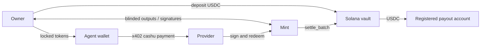

# Blindfold: Design

[Run locally](RUNNING.md) · [Interfaces](design/00-interfaces.md) · [Scope](mvp.md)

## One purchase end to end

1. **Deposit.** The owner obtains a quote with a random `deposit_ref` and deposits whole-cent USDC into the vault. The mint polls `Config.deposit_count` and the program's `DepositRecord` accounts; it does not infer payment from raw transaction instructions.
2. **Issue.** The owner builds secrets locked 1-of-N to all active provider keys, blinds them and obtains mint signatures. NUT-20 binds mint requests to the owner's quote key. The owner unblinds, checks DLEQ proofs and writes the tokens to the agent's file.
3. **Pay.** The provider offers x402 v2 scheme `cashu`. The wallet checks mint, unit, asset, provider and price, selects an exact amount and persists it as pending before sending it.
4. **Redeem.** The provider signs the proofs. The mint verifies signatures and locks, atomically marks proofs spent and credits that provider. The provider serves data only after successful redemption. This includes cryptographic verification and a database transaction; no latency bound is guaranteed.
5. **Settle.** A timer (default 60 seconds) or admin request pays up to eight active providers per batch. Timers are relative to process startup, not globally synchronized settlement windows.

## Blind signatures and compatibility

Cashu's BDHKE scheme on secp256k1 is implemented through `@cashu/cashu-ts`. For secret `x` and random blinding factor `r`, the owner sends `B_ = hash_to_curve(x) + rG`. The mint returns `C_ = kB_`; the owner computes `C = C_ - rK`. At redemption the mint checks `C = k·hash_to_curve(x)`.

Blinding prevents matching signatures to redeemed secrets from the cryptographic transcript alone. It does not hide amounts, timing or network metadata. Publishing blinded outputs would not publish secrets, but their amounts and timestamps could still aid correlation.

The implementation uses Cashu keysets (NUT-01/02), a custom `solana-usdc` mint method (NUT-04), checkstate (NUT-07), restricted P2PK locks (NUT-10/11), DLEQ proofs (NUT-12) and signed quotes (NUT-20). It uses `cashuB` token encoding. Swap (NUT-03), melt (NUT-05), refunds and general Cashu-wallet interoperability are not implemented. A standard wallet would need support for this mint method and payment scheme.

The provider acts as an in-process x402 facilitator. Its successful x402 `transaction` value is the mint's redemption ID. USDC moves in a later vault transaction.

## Spending controls

| Control | Enforcement and limit |
|---|---|
| Budget | Agent can spend the tokens it holds; it can waste all of them at allowed providers |
| Provider lock | Owner-created 1-of-N P2PK lock includes active registered providers at funding time; mint credits the key that signed |
| Narrower allowlist | `WALLET_ALLOWLIST` is wallet policy, not an additional token restriction |
| Per-call price cap | Wallet and x402 spend controls; not encoded in tokens |
| Exact amount | No change or swap; wallet must find proofs summing to the price |
| Reserve gate | Agent reads the vault and compares against mint-reported liabilities; errors stop payment |

The mint cannot inspect a blinded secret at issuance. It validates its lock at redemption. The owner must build and verify the lock correctly. New providers do not acquire access to old tokens, and deactivated providers cannot redeem after the mint syncs their status.

## Custody and reserves

The vault holds a configured classic SPL mint; the deployment must choose the intended six-decimal USDC mint. It pays only registered payout accounts, but the mint authority chooses amounts. A compromised mint can drain reserves to those accounts. The admin controls registration and deactivation; the upgrade authority can change program behavior. `initialize` is first-caller-wins and is not restricted to the deployer.

`outstanding = issued - settled` includes both unredeemed tokens and redeemed balances awaiting payout. Issuance and settlement accounting come from the mint's database. The agent rounds the public vault balance down to whole cents so a direct sub-cent transfer cannot disable the check, but that does not prove the reported liabilities are complete. Reads of RPC state and database state are not an atomic snapshot, so a concurrent payout can also cause a conservative refusal.

The admin reconciliation endpoint reports `vault_balance`, `deposited`, `issued`, `redeemed` and `settled`. In an isolated test with no direct transfers, `vault_balance == deposited - settled`. Direct transfers, unprocessed deposits or pending confirmations can break that identity without proving theft. There is no public onchain issuance log yet.

## Privacy and failure limits

| Observation or failure | Current behavior |
|---|---|
| Public chain | Shows depositor, amount, deposit reference and registered provider payouts; no per-call onchain payment |
| Provider | Sees query and token proofs; can also observe client network metadata |
| Mint | Sees deposits, issuance amounts, provider redemptions and timing; blinding hides the direct issuance-to-proof link |
| Small population or distinctive amounts | Can make correlation easy; privacy is not guaranteed |
| Leaked tokens | Anyone holding them can submit payments to allowed providers; locks prevent arbitrary-recipient redemption, not budget theft through allowed services |
| Double spend | Online redemption and a unique spent-proof key prevent double credit |
| Lost redemption response | Provider may be paid without serving data; wallet uses checkstate to drop spent proofs or recover unspent ones |
| Mint outage | No online redemption, so provider serves no paid data; unresolved wallet proofs remain pending |

The current provider does not log client IPs, token headers or secrets. Omitting those logs is not network anonymity. There is no shared relay, Tor/OHTTP layer, sanctions screening or refund path. The $50 default is a per-deposit cap, not an aggregate budget or identity control.

## Baseline comparison

The mock API can also accept the standard x402 `exact` scheme on the same routes, and `scripts/bot.ts` observes the chain like a competitor would. With `exact`, every call is a USDC transfer from the agent's wallet to the provider, so the observer learns the payer, the provider, each amount and each time. With `cashu`, it sees owner deposits into the vault and batched vault payouts, with no agent wallet and no per-call transaction. `pnpm demo` runs both flows side by side ([demo](DEMO.md)).

## Planned work

See [MVP and add-ons](mvp.md#add-ons) for priority. These are design options, not current features:

- A complete prompt-injection demo using the existing hostile-response test hooks.
- QuickNode Streams to trigger deposit polling; the mint currently polls without a webhook.
- Owner approval through a second, co-signed reserve pocket. Current locks accept only 1-of-N and reject refund/time-lock tags; this requires protocol changes.
- Temporal for durable top-ups. Workflow randomness and signing would run in activities; existing persisted funding checkpoints still have recovery limits.
- Onchain issuance logging and an external reconciliation view.
- Hidden provider revenue through fresh payout accounts or chunked withdrawals. This would require changing the current fixed payout registry and reassessing the trust model; current provider revenue remains public.
